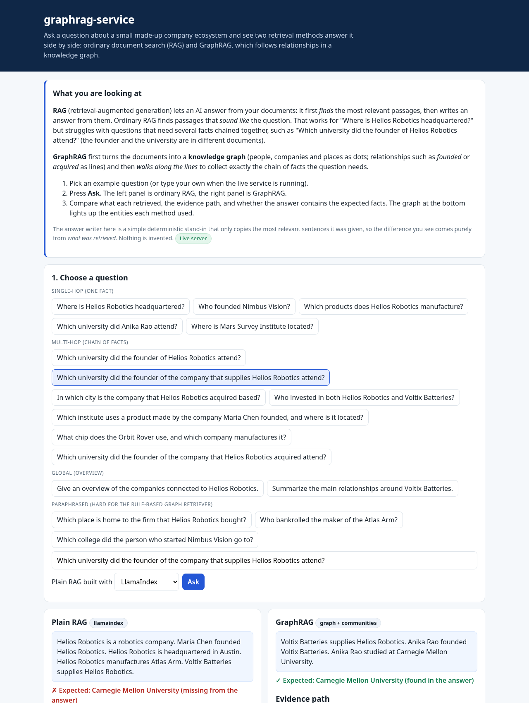
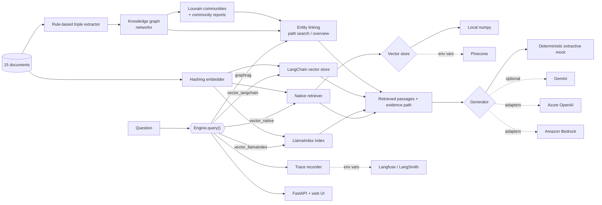

**▶ Live demo (no login, click and run): https://tanvir-ux.github.io/graphrag-service/**

# graphrag-service

A small, fully tested service that answers the same question two ways and shows the difference: ordinary **vector RAG** (find passages that sound like the question) and **GraphRAG** (turn the documents into a knowledge graph, then follow relationships to collect the chain of facts a question needs). It is built with **LlamaIndex** and **LangChain**, with pluggable **Pinecone**, **Amazon Bedrock** and **Azure OpenAI** adapters, an **evaluation harness**, and **Langfuse / LangSmith** tracing hooks.

[](https://github.com/tanvir-ux/graphrag-service/actions/workflows/ci.yml)




## What this demonstrates

| Area | What is in the repository |
| --- | --- |
| Vector RAG | Three interchangeable retrievers over one embedding: a native one with a pluggable vector store, a **LlamaIndex** `VectorStoreIndex`, and a **LangChain** `InMemoryVectorStore` |
| GraphRAG | Triple extraction, a `networkx` knowledge graph, Louvain community detection with community reports, entity linking, relation-aware multi-hop path search, and a global "overview" strategy |
| Adapters | Pinecone vector store, Azure OpenAI chat and embeddings, Amazon Bedrock Converse and Titan embeddings, an OpenAI-compatible client used for Gemini |
| Evaluation | 17 questions in four categories, four pipelines, document recall, answer correctness and context size, including questions that deliberately break the GraphRAG retriever |
| Observability | An in-process trace recorder (drives the UI), plus Langfuse and LangSmith wrappers that switch on from environment variables |
| Service | FastAPI app with REST endpoints, OpenAPI docs at `/docs`, a rate-limited optional live-LLM mode and a no-login web UI |

## Architecture



The corpus is a made-up robotics ecosystem ("Helios Robotics", 15 short documents, one fact per sentence), so no one can mistake the answers for general knowledge. The default generator is a deterministic mock that copies the most relevant retrieved sentences. That means every difference you see in the demo comes from **what was retrieved**, not from how well a language model writes.

## What ran live and what did not

This table is the honest status of the repository as published.

| Item | Status |
| --- | --- |
| Knowledge-graph build, all four retrievers, evaluation harness, CLI | **Executed**: 54 unit tests pass; the output is in [`docs/demo/`](docs/demo) |
| FastAPI endpoints and web UI | **Executed** (tests, plus a headless-browser click-through of the example questions) |
| Real LLM answers (Gemini `gemini-3.1-flash-lite`, free tier) | **Executed once, on 6 of the 17 questions** (12 requests): plain RAG 3/6 correct, GraphRAG 6/6. Raw log: [`docs/demo/live-gemini.txt`](docs/demo/live-gemini.txt). A tiny sample, not a benchmark |
| Pinecone vector store | **Not executed against Pinecone.** Unit-tested with a fake index (no Pinecone key was available). The service uses it only when `PINECONE_API_KEY` and `PINECONE_INDEX` are set; the index needs dimension 512 |
| Azure OpenAI chat and embeddings | **Not executed against Azure.** Request and response shapes are tested with an `httpx` mock transport |
| Amazon Bedrock (Converse, Titan embeddings) | **Not executed against AWS.** Tested with the botocore `Stubber` and dummy credentials |
| Langfuse and LangSmith hooks | **Unit-tested with fake SDKs only.** Nothing was sent to the hosted services |
| Hosted demo on GitHub Pages | **Recorded replay** of real runs of the example questions. It is not a live backend |
| Docker image | **Executed in GitHub Actions**: the CI job builds the image, starts it and queries it |
| Hugging Face Space publish script (`deploy/huggingface`) | **Written but not executed** (no Hugging Face token was available when this was built) |

## Evaluation

`graphrag eval` runs 17 questions through all four pipelines with the deterministic generator. "Answer accuracy" means the answer contains every expected fact; "doc recall" is the share of the needed source documents that were retrieved. Full output: [`docs/demo/eval.txt`](docs/demo/eval.txt).

| Pipeline | Single-hop (5) | Multi-hop (7) | Global (2) | Paraphrase (3) | All (17) |
| --- | --- | --- | --- | --- | --- |
| Vector, native | 1.00 | 0.43 | 0.00 | 0.00 | 0.47 |
| Vector, LlamaIndex | 1.00 | 0.43 | 0.00 | 0.00 | 0.47 |
| Vector, LangChain | 1.00 | 0.43 | 0.00 | 0.00 | 0.47 |
| GraphRAG | 1.00 | 1.00 | 1.00 | 0.33 | 0.88 |

Read this with care:

- **The questions, the corpus and the relation lexicon were written by the same person** (me). This is a demonstration of the method, not a general benchmark, and the margin on multi-hop questions would shrink on real text.
- The GraphRAG extractor is rule-based (entity patterns plus a verb lexicon). The three **paraphrase** questions ("bought" instead of "acquired", "bankrolled" instead of "invested in") are included on purpose: it fails on most of them (recall 0.17). A production system would use an LLM extractor and keep the graph in a store such as Neo4j.
- The vector pipelines use a small hashing embedder (no model download), so they are weaker than a good embedding model. Plain RAG would do better with one, particularly on paraphrases.
- On the live Gemini check, plain RAG missed the two-hop and overview questions because the retrieved passages did not contain the chain, and the model correctly said so instead of inventing an answer.

## Quick start

Python 3.11 or newer.

```bash
git clone https://github.com/tanvir-ux/graphrag-service && cd graphrag-service
python -m venv .venv && source .venv/bin/activate
pip install -r requirements.txt     # pinned versions
pip install --no-deps -e .

graphrag graph                                   # entities, relations, community reports
graphrag ask "Which university did the founder of the company that supplies Helios Robotics attend?"
graphrag ask --mode vector_langchain "Where is Helios Robotics headquartered?"
graphrag eval                                    # markdown table
graphrag serve                                   # UI at http://127.0.0.1:8000, docs at /docs
```

Or with Docker:

```bash
docker build -t graphrag-service . && docker run -p 7860:7860 graphrag-service
```

### API

| Endpoint | Purpose |
| --- | --- |
| `GET /api/health` | liveness |
| `GET /api/examples` | example questions with expected answers |
| `GET /api/graph` | nodes, edges and community reports |
| `POST /api/query` | `{"question": "...", "mode": "graphrag", "llm": "mock"}` returns answer, passages, evidence paths and a trace |
| `GET /api/eval` | the evaluation table |

### Optional: real models, vector store and tracing

| Variable | Effect |
| --- | --- |
| `GRAPHRAG_LLM=gemini` and `GEMINI_API_KEY` | Use Gemini for answers (`GEMINI_MODEL` selects the model); also `graphrag ask --llm gemini` |
| `ENABLE_GEMINI_DEMO=1` | Allow `"llm": "gemini"` on `/api/query`, limited per client and overall (`GEMINI_DEMO_PER_IP_HOURLY`, `GEMINI_DEMO_TOTAL_HOURLY`). Keys stay server-side |
| `PINECONE_API_KEY`, `PINECONE_INDEX` (`PINECONE_NAMESPACE`) | Use Pinecone as the vector store of the native retriever |
| `AZURE_OPENAI_ENDPOINT`, `AZURE_OPENAI_API_KEY`, `AZURE_OPENAI_DEPLOYMENT` (`AZURE_OPENAI_EMBEDDING_DEPLOYMENT`, `AZURE_OPENAI_API_VERSION`) | Azure OpenAI generator (`--llm azure`) and embedder |
| `AWS_REGION` plus standard AWS credentials, `BEDROCK_MODEL_ID` | Amazon Bedrock generator (`--llm bedrock`) and Titan embedder |
| `LANGFUSE_PUBLIC_KEY`, `LANGFUSE_SECRET_KEY` | Wrap pipeline steps with Langfuse `observe` |
| `LANGSMITH_API_KEY`, `LANGSMITH_TRACING=true` | Wrap pipeline steps with LangSmith `traceable` |

## Development

```bash
pip install pytest pytest-asyncio ruff
ruff check . && ruff format --check .
pytest -q
python scripts/record.py              # regenerate the Pages replay (a test checks it is in sync)
python scripts/live_gemini_eval.py    # optional live check, needs GEMINI_API_KEY, 12 requests
```

CI (`.github/workflows/ci.yml`) runs lint and tests and builds and queries the Docker image. Pages deployment is in `pages.yml`.

## Repository layout

```
src/graphrag_service/
  corpus.py             the 15 synthetic documents
  graph/                extract.py (triples), build.py (graph, communities), retrieve.py (GraphRAG)
  rag/vector.py         native, LlamaIndex and LangChain retrievers
  embeddings.py         hashing embedder, no downloads
  stores.py             local and Pinecone vector stores
  llm.py                mock, Gemini, and the provider factory
  adapters/             azure_openai.py, bedrock.py
  evaluation/           questions and harness
  trace.py              recorder, Langfuse and LangSmith wrappers
  api.py, cli.py        FastAPI app and command line
  web/index.html        the UI (also used as the Pages demo)
tests/                  54 tests
docs/                   Pages site, screenshot, demo logs
deploy/huggingface/     Space metadata and publish script (not executed)
```

## Licence

MIT, see [LICENSE](LICENSE).
